# Activity Diagram — SI-LKABK

---

## US-01 — Login Sistem

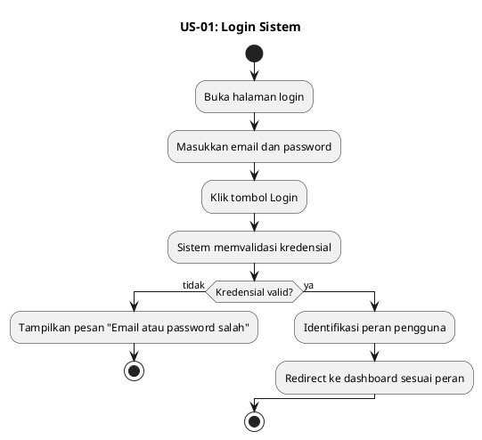

---

## US-02 — Logout Sistem

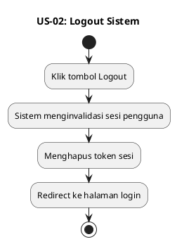

---

## US-03 — Kelola Akun Pengguna

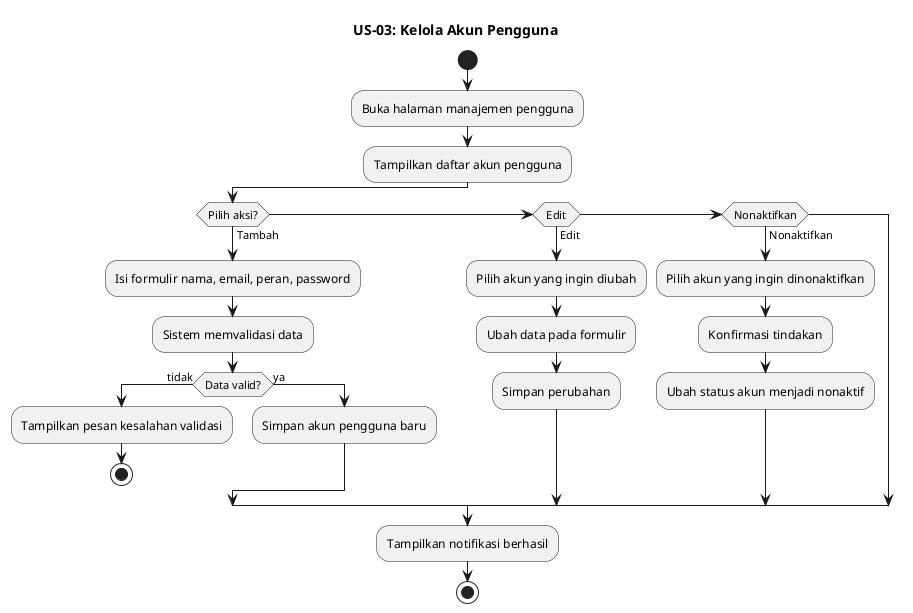

---

## US-04 — Pendaftaran Pasien

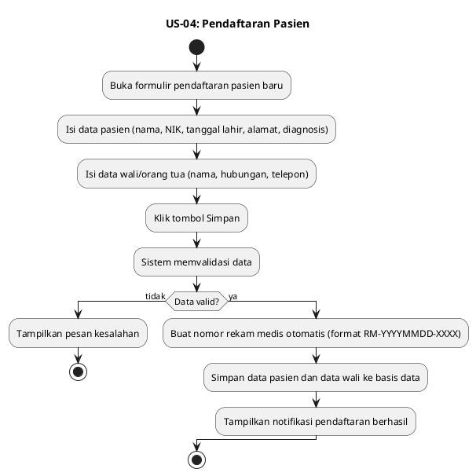

---

## US-05 — Pendaftaran Layanan

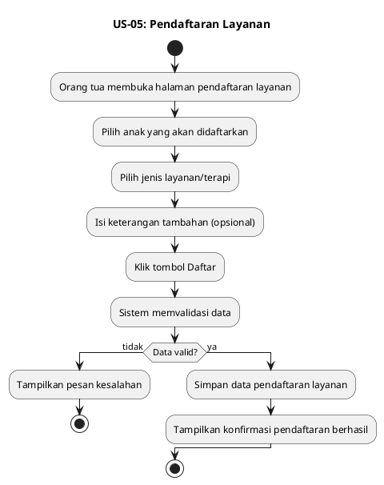

---

## US-06 — Kelola Data Pasien

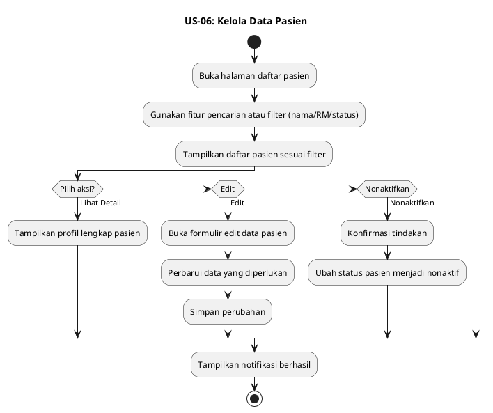

---

## US-07 — Pencatatan Pembayaran

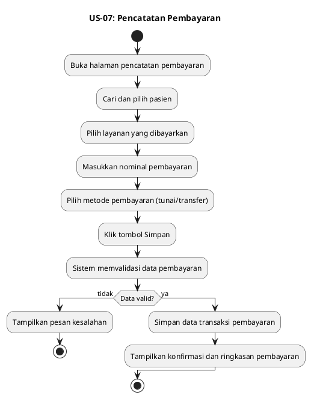

---

## US-08 — Riwayat Pembayaran

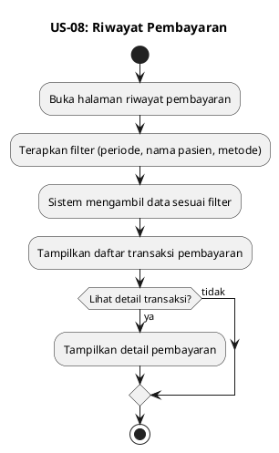

---

## US-09 — Lihat Bukti Pembayaran

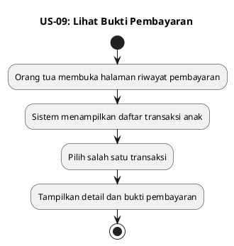

---

## US-10 — Kelola Jadwal Terapi

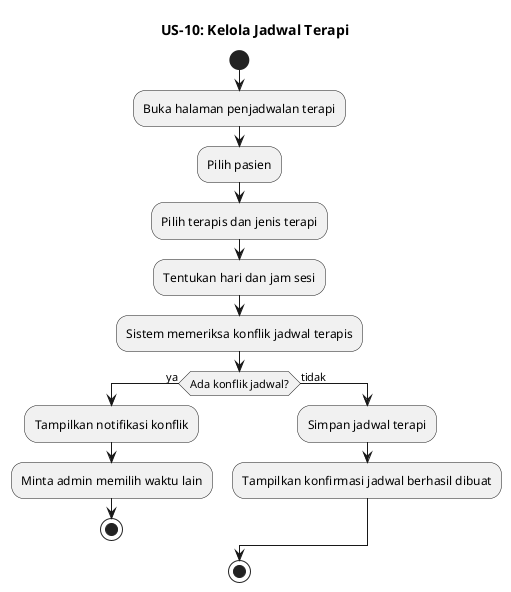

---

## US-11 — Lihat Jadwal Terapi

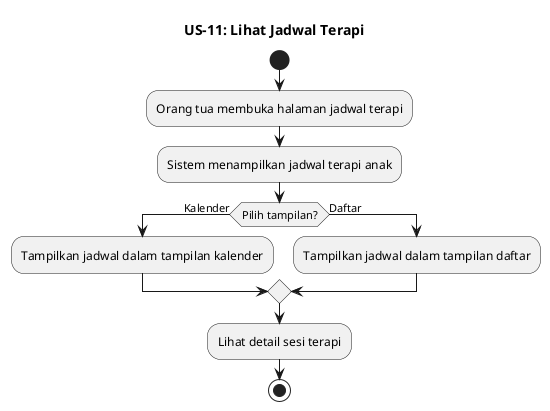

---

## US-12 — Lihat Jadwal Terapis

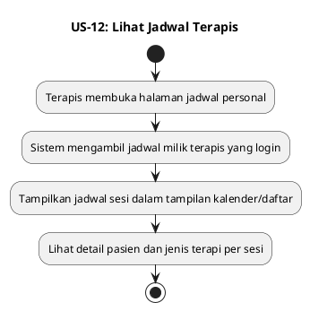

---

## US-13 — Catat Hasil Terapi

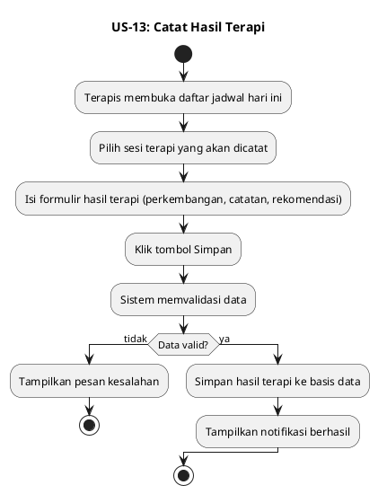

---

## US-14 — Kelola Rekam Medis

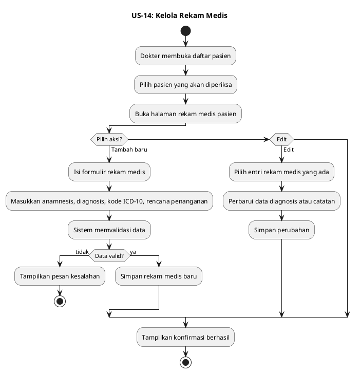

---

## US-15 — Evaluasi Perkembangan Anak (KPSP)

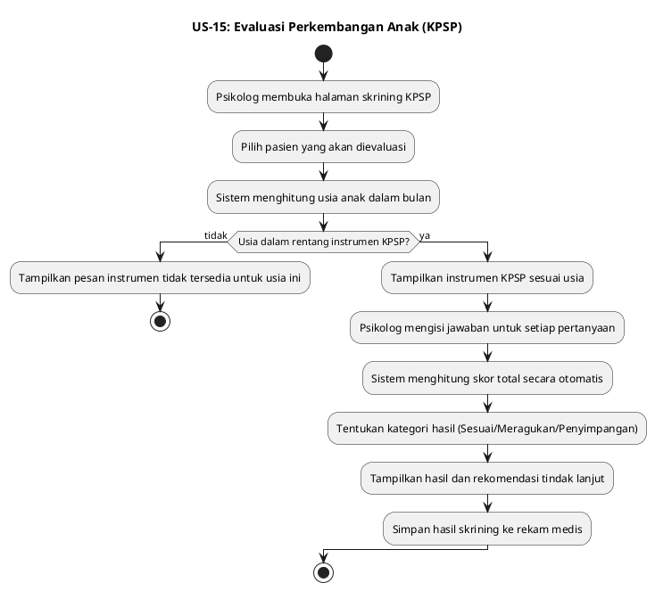

---

## US-16 — Riwayat Layanan Pasien

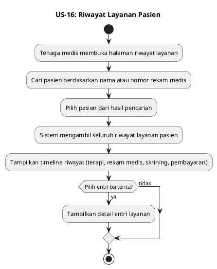

---

## US-17 — Laporan Layanan

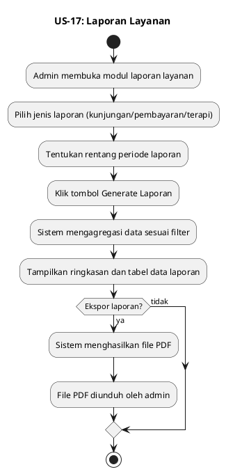

---

## US-18 — Pencarian Data Pasien

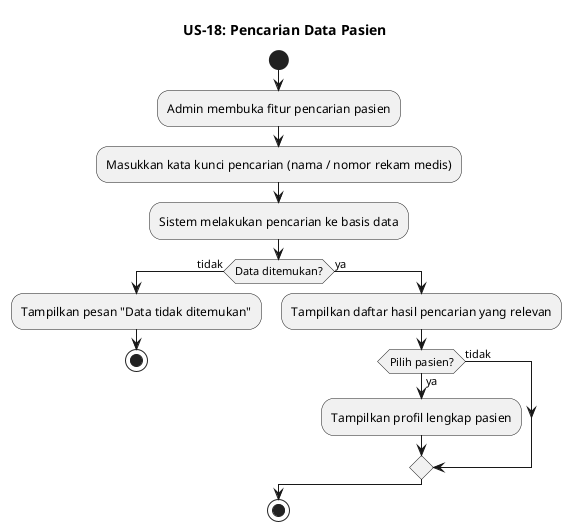
