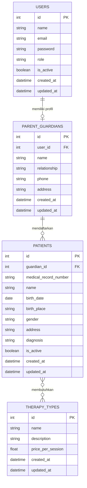
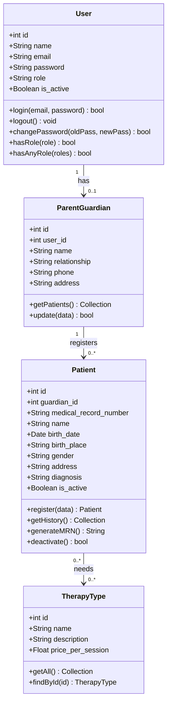
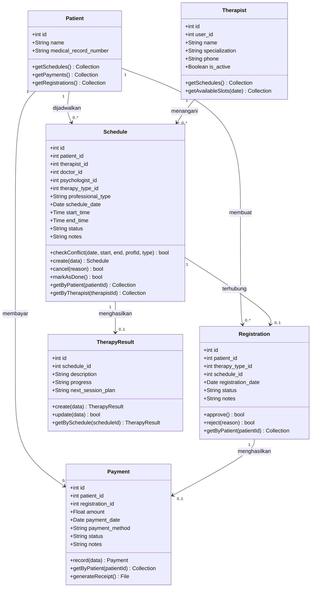
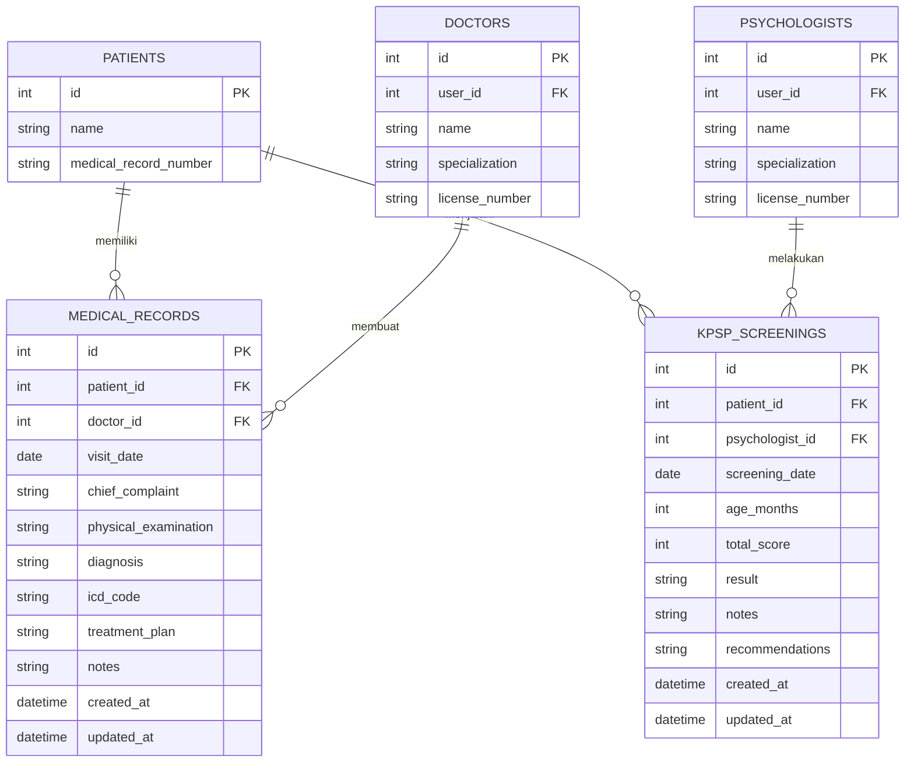
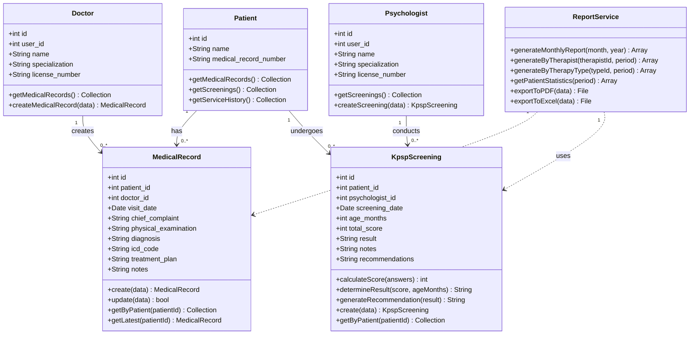
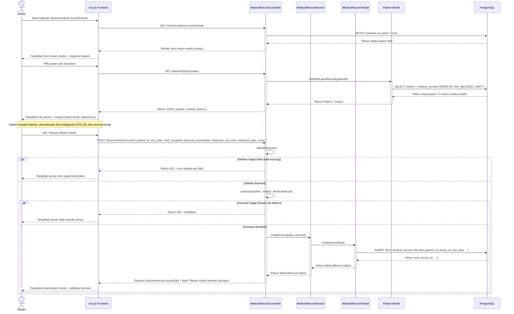

# Diagram Sistem SI-LKABK
## ERD, Class Diagram, dan Sequence Diagram Per Iterasi

---

# ITERASI 1 — Autentikasi, Manajemen Akun, dan Pendaftaran Pasien

## ERD Iterasi 1

ERD pada iterasi pertama dirancang untuk mengakomodasi entitas-entitas yang
terlibat dalam proses autentikasi, manajemen akun, dan pendaftaran pasien.
Entitas `users` berfungsi sebagai tabel autentikasi pusat. Relasi antara `users`
dan `parent_guardians` bersifat *one-to-one*, sedangkan relasi antara
`parent_guardians` dan `patients` bersifat *one-to-many*.



---

## Class Diagram Iterasi 1

*Class diagram* pada iterasi ini mendefinisikan struktur kelas dan hubungan
antarkelas yang diimplementasikan. Kelas `User` berperan sebagai entitas pusat
dengan atribut peran (*role*) yang menentukan hak akses. Kelas `ParentGuardian`
memiliki relasi *one-to-one* dengan `User` dan relasi *one-to-many* dengan
`Patient`.



---

## Sequence Diagram Iterasi 1 — Login Sistem

Diagram ini menggambarkan alur interaksi antara pengguna dengan sistem pada saat
proses *login*, mulai dari pengisian formulir hingga pengarahan ke *dashboard*
sesuai peran. Terdapat tiga skenario alternatif: validasi gagal, *password* salah,
dan akun nonaktif.

```mermaid
sequenceDiagram
    actor Pengguna
    participant Vue  as Vue.js Frontend
    participant AC   as AuthController
    participant AS   as AuthService
    participant UM   as User Model
    participant DB   as PostgreSQL

    Pengguna ->> Vue  : Buka halaman /login
    Vue      ->> AC   : GET /login
    activate AC
    AC       -->> Vue : Render halaman login (Inertia)
    deactivate AC
    Vue      -->> Pengguna : Tampilkan form login

    Pengguna ->> Vue  : Isi email + password, klik "Login"
    Vue      ->> AC   : POST /login { email, password }
    activate AC

    AC ->> AC : validate(request)

    alt Validasi Gagal (kolom kosong / format salah)
        AC -->> Vue : Return 422 - error validasi
        Vue -->> Pengguna : Tampilkan pesan error validasi
    else Validasi Berhasil
        AC  ->> AS  : attempt(email, password)
        activate AS

        AS  ->> UM  : findByEmail(email)
        activate UM
        UM  ->> DB  : SELECT * FROM users WHERE email = ?
        activate DB
        DB  -->> UM : Return data user / null
        deactivate DB
        UM  -->> AS : Return User object / null
        deactivate UM

        alt User Tidak Ditemukan
            AS -->> AC : Authentication failed
            AC -->> Vue : Return error "Email atau password salah"
            Vue -->> Pengguna : Tampilkan pesan kesalahan
        else User Ditemukan
            AS ->> AS : verifyPassword(password, hash)

            alt Password Salah
                AS -->> AC : Authentication failed
                AC -->> Vue : Return error "Email atau password salah"
                Vue -->> Pengguna : Tampilkan pesan kesalahan
            else Password Benar
                AS ->> UM : checkIsActive(user)
                UM ->> DB : SELECT is_active FROM users WHERE id = ?
                DB -->> UM : Return is_active
                UM -->> AS : Return status aktif

                alt Akun Nonaktif
                    AS -->> AC : Account disabled
                    deactivate AS
                    AC -->> Vue : Return error "Akun Anda tidak aktif"
                    Vue -->> Pengguna : Tampilkan pesan akun nonaktif
                else Akun Aktif
                    AS ->> AS : createSession(user)
                    AS -->> AC : Return authenticated user
                    deactivate AS
                    AC ->> AC : redirectByRole(user.role)
                    AC -->> Vue : Redirect ke /dashboard
                    deactivate AC
                    Vue -->> Pengguna : Tampilkan dashboard sesuai role
                end
            end
        end
    end
```

---
---

# ITERASI 2 — Penjadwalan Terapi dan Pembayaran

## ERD Iterasi 2

ERD pada iterasi kedua diperluas dengan menambahkan entitas tenaga profesional
(`therapists`, `doctors`, `psychologists`) dan entitas operasional layanan
(`schedules`, `registrations`, `therapy_results`, `payments`). Entitas
`schedules` menjadi pusat relasi yang menghubungkan pasien dengan tenaga
profesional dan jenis terapi.

```mermaid
erDiagram
    PATIENTS {
        int id PK
        string name
        string medical_record_number
    }

    THERAPY_TYPES {
        int id PK
        string name
        float price_per_session
    }

    THERAPISTS {
        int id PK
        int user_id FK
        string name
        string specialization
        string phone
        boolean is_active
        datetime created_at
        datetime updated_at
    }

    DOCTORS {
        int id PK
        int user_id FK
        string name
        string specialization
        boolean is_active
        datetime created_at
        datetime updated_at
    }

    PSYCHOLOGISTS {
        int id PK
        int user_id FK
        string name
        string specialization
        boolean is_active
        datetime created_at
        datetime updated_at
    }

    SCHEDULES {
        int id PK
        int patient_id FK
        int therapist_id FK
        int doctor_id FK
        int psychologist_id FK
        int therapy_type_id FK
        string professional_type
        date schedule_date
        time start_time
        time end_time
        string status
        string notes
        int created_by FK
        datetime created_at
        datetime updated_at
    }

    REGISTRATIONS {
        int id PK
        int patient_id FK
        int therapy_type_id FK
        int schedule_id FK
        date registration_date
        string status
        string notes
        datetime created_at
        datetime updated_at
    }

    THERAPY_RESULTS {
        int id PK
        int schedule_id FK
        string description
        string progress
        string next_session_plan
        datetime created_at
        datetime updated_at
    }

    PAYMENTS {
        int id PK
        int patient_id FK
        int registration_id FK
        float amount
        date payment_date
        string payment_method
        string status
        string notes
        datetime created_at
        datetime updated_at
    }

    PATIENTS         ||--o{  SCHEDULES        : "dijadwalkan dalam"
    THERAPISTS       ||--o{  SCHEDULES        : "menangani"
    DOCTORS          ||--o{  SCHEDULES        : "menangani"
    PSYCHOLOGISTS    ||--o{  SCHEDULES        : "menangani"
    THERAPY_TYPES    ||--o{  SCHEDULES        : "digunakan pada"
    SCHEDULES        ||--o|  THERAPY_RESULTS  : "menghasilkan"
    PATIENTS         ||--o{  REGISTRATIONS    : "membuat"
    THERAPY_TYPES    ||--o{  REGISTRATIONS    : "untuk jenis"
    SCHEDULES        ||--o|  REGISTRATIONS    : "terhubung ke"
    PATIENTS         ||--o{  PAYMENTS         : "membayar"
    REGISTRATIONS    ||--o|  PAYMENTS         : "menghasilkan"
```



---

## Class Diagram Iterasi 2

*Class diagram* pada iterasi 2 menambahkan kelas-kelas yang berkaitan dengan
penjadwalan dan pembayaran. Kelas `Schedule` memiliki metode `checkConflict()`
sebagai logika bisnis utama untuk mencegah bentrok jadwal antar pasien maupun
tenaga profesional.



---

## Sequence Diagram Iterasi 2 — Buat Jadwal Terapi

Diagram ini menggambarkan alur pembuatan jadwal terapi oleh admin. Bagian kritis
dari alur ini adalah pengecekan konflik jadwal (`checkConflict`) sebelum data
jadwal disimpan ke basis data, untuk memastikan tidak ada bentrok waktu pada
terapis maupun pasien yang sama.

```mermaid
sequenceDiagram
    actor Admin
    participant Vue  as Vue.js Frontend
    participant SC   as ScheduleController
    participant SS   as ScheduleService
    participant SM   as Schedule Model
    participant DB   as PostgreSQL

    Admin ->> Vue : Buka halaman /schedules/create
    Vue   ->> SC  : GET /schedules/create
    activate SC
    SC    ->> DB  : SELECT patients, therapists, therapy_types
    DB    -->> SC : Return master data
    SC    -->> Vue : Render form jadwal (Inertia)
    deactivate SC
    Vue   -->> Admin : Tampilkan form pembuatan jadwal

    Admin ->> Vue : Pilih pasien, terapis, tanggal, jam mulai/selesai, jenis terapi
    Admin ->> Vue : Klik "Simpan Jadwal"
    Vue   ->> SC  : POST /schedules { patient_id, therapist_id, schedule_date, start_time, end_time, therapy_type_id }
    activate SC

    SC ->> SC : validate(request)

    alt Validasi Gagal (field kosong / format salah)
        SC -->> Vue : Return 422 - pesan validasi
        Vue -->> Admin : Tampilkan error pada field terkait
    else Validasi Berhasil
        SC  ->> SS  : createSchedule(validatedData)
        activate SS

        Note over SS, SM : Cek konflik jadwal terapis
        SS  ->> SM  : checkConflict(date, start, end, therapistId, "terapis")
        activate SM
        SM  ->> DB  : SELECT * FROM schedules WHERE therapist_id = ? AND schedule_date = ? AND status != "cancelled" AND (start_time < ? AND end_time > ?)
        activate DB
        DB  -->> SM : Return daftar jadwal yang konflik
        deactivate DB
        SM  -->> SS : Return konflik (ada / tidak)
        deactivate SM

        alt Ada Konflik Jadwal
            SS -->> SC : Throw ConflictException
            deactivate SS
            SC -->> Vue : Return 422 - "Terdapat konflik jadwal pada waktu tersebut"
            deactivate SC
            Vue -->> Admin : Tampilkan pesan konflik + slot yang bentrok
        else Tidak Ada Konflik
            SS  ->> SM  : create(scheduleData)
            activate SM
            SM  ->> DB  : INSERT INTO schedules VALUES (...)
            activate DB
            DB  -->> SM : Return schedule baru (id, data)
            deactivate DB
            SM  -->> SS : Return Schedule object
            deactivate SM
            SS  -->> SC : Return Schedule object
            deactivate SS
            SC  -->> Vue : Redirect /schedules + flash "Jadwal berhasil dibuat"
            deactivate SC
            Vue -->> Admin : Tampilkan daftar jadwal + notifikasi sukses
        end
    end
```

---
---

# ITERASI 3 — Rekam Medis Elektronik, Evaluasi Perkembangan, dan Laporan

## ERD Iterasi 3

ERD pada iterasi ketiga menambahkan entitas `medical_records` dan
`kpsp_screenings`. Entitas `medical_records` terhubung ke `patients` dan
`doctors`, sedangkan `kpsp_screenings` terhubung ke `patients` dan
`psychologists`. Keduanya bersifat *many-to-one* terhadap `patients`, artinya
satu pasien dapat memiliki banyak rekam medis dan banyak riwayat *screening*.



---

## Class Diagram Iterasi 3

*Class diagram* pada iterasi 3 menambahkan kelas `MedicalRecord`, `KpspScreening`,
dan `ReportService`. Kelas `KpspScreening` memiliki metode bisnis penting yaitu
`calculateScore()` untuk menghitung skor secara otomatis dan `determineResult()`
untuk mengkategorikan hasil *screening* berdasarkan skor dan usia anak. Kelas
`ReportService` bersifat *stateless* dan digunakan untuk menghasilkan laporan dari
berbagai modul.



---

## Sequence Diagram Iterasi 3 — Input Rekam Medis Elektronik

Diagram ini menggambarkan alur dokter dalam mengisi rekam medis elektronik pasien.
Alur mencakup pemuatan data riwayat pasien sebelumnya untuk mendukung keputusan
klinis, pengisian formulir rekam medis, validasi dan otorisasi, hingga penyimpanan
data ke basis data.


